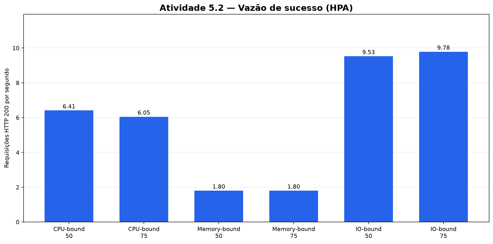
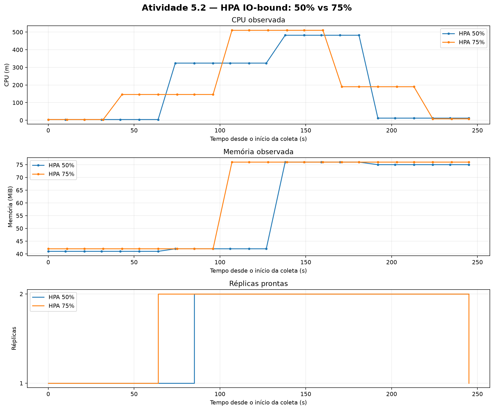
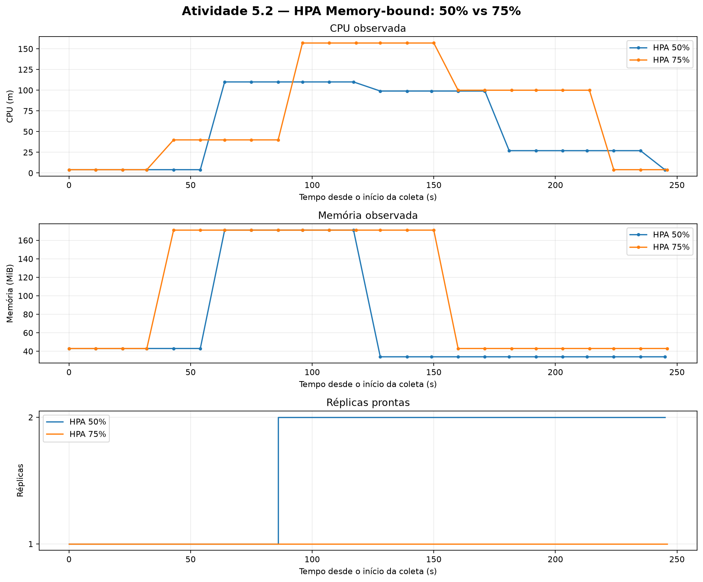
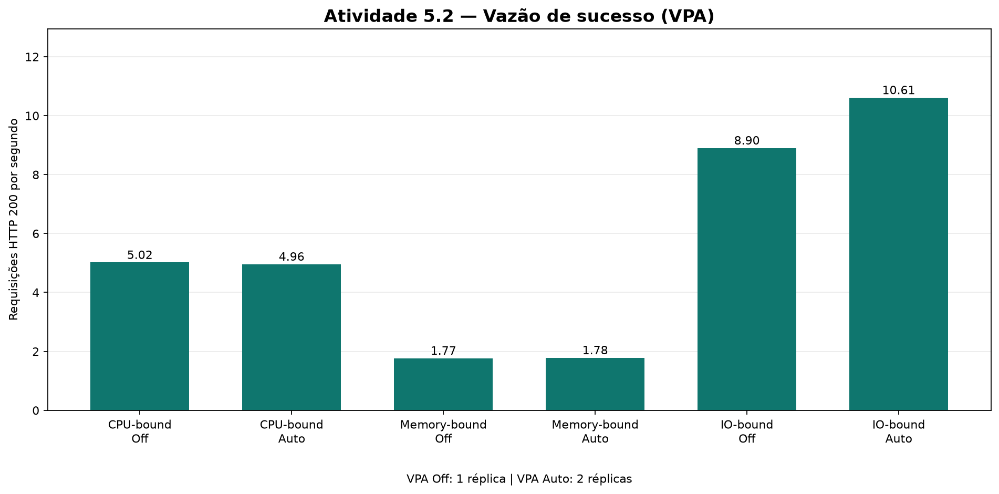
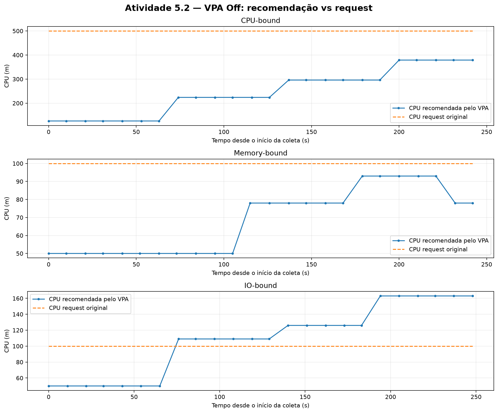
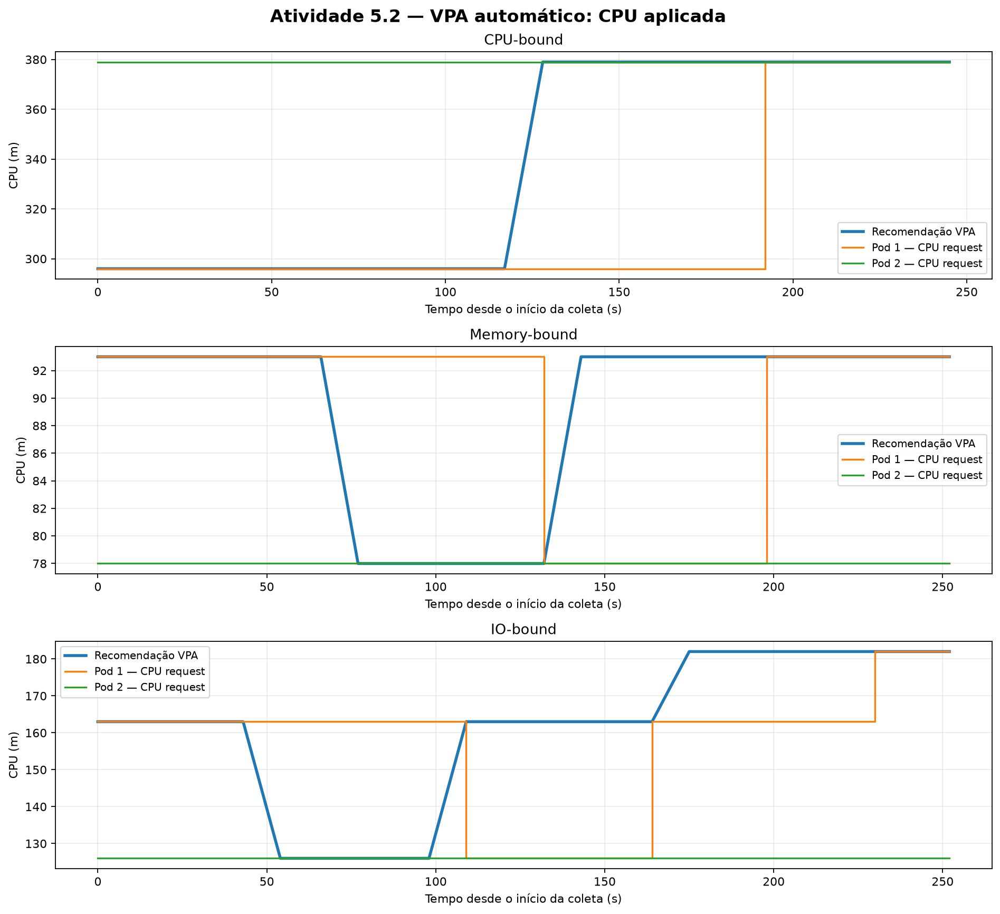
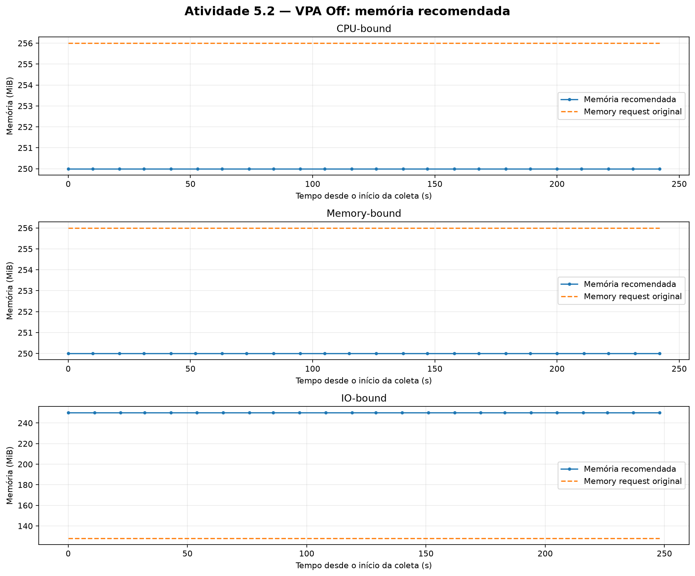
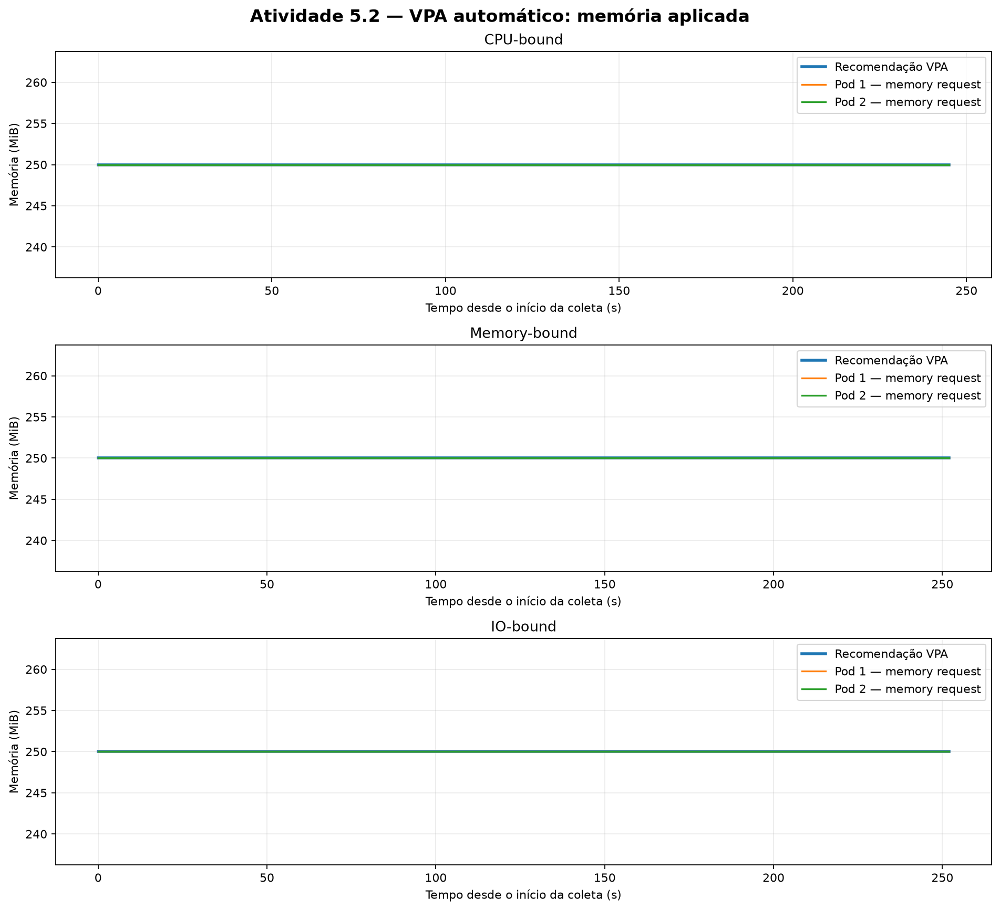
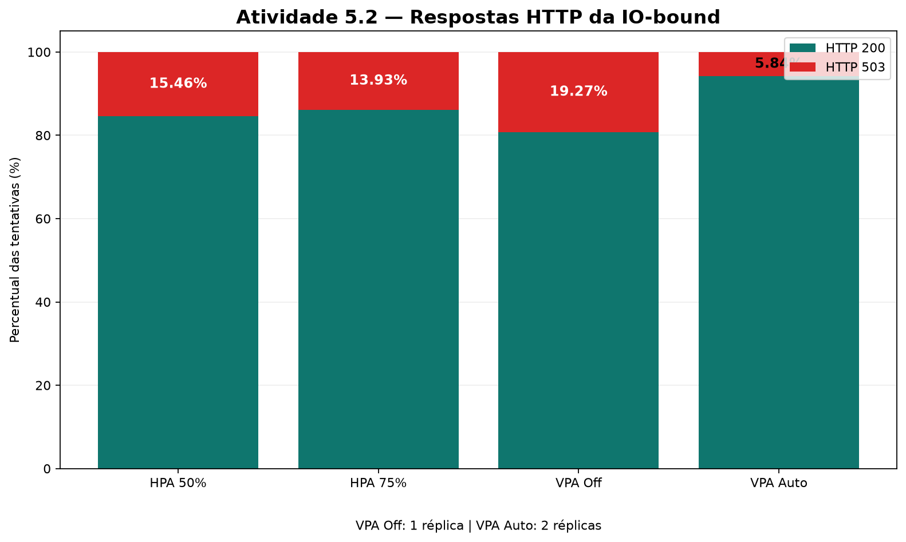

# Atividade 5.2 — Autoscaling com HPA e VPA no Kubernetes

**Grupo:** 23
**Alunos:** Arthur Vidal Regis Gouveia; Pedro Henriques Barros Pereira
**Matrículas:** 123110755; 123110565
**Data dos experimentos:** 28/11/2026

## 1. Introdução

Esta atividade investiga o comportamento de mecanismos de autoscaling
do Kubernetes em três aplicações com características distintas:

- **CPU-bound:** processamento intensivo de CPU.
- **Memory-bound:** alocação e utilização de memória.
- **IO-bound:** operações de entrada e saída com arquivos.

Foram estudados dois mecanismos:

- **Horizontal Pod Autoscaler (HPA):** ajusta a quantidade de réplicas.
- **Vertical Pod Autoscaler (VPA):** recomenda ou ajusta os recursos
  solicitados pelos contêineres.

O objetivo é comparar as políticas de escalonamento, observar o consumo
de recursos e analisar a capacidade de atendimento durante a carga.

## 2. Infraestrutura experimental

Os experimentos foram executados em uma VM Ubuntu Server 24.04,
provisionada no ambiente OpenStack, com aproximadamente:

| Recurso | Configuração |
| --- | --- |
| CPU da VM | 4 vCPUs |
| Memória da VM | 7,8 GiB |
| Disco raiz | Aproximadamente 19 GiB |
| Orquestrador | Kubernetes v1.37.0 |
| Cliente kubectl | v1.37.3 |
| Minikube | v1.39.0 |
| Runtime | containerd 2.3.4 |
| Nós Kubernetes | 1 |
| Namespace | `poi-atividade5` |

O Minikube foi executado com o driver Docker. Foram implantadas três
aplicações por meio de Deployments:

| Aplicação | Deployment | Endpoint de carga |
| --- | --- | --- |
| CPU-bound | `poi-cpu` | `/primos?limite=100000` |
| Memory-bound | `poi-memory` | `/memoria?tamanho_mb=64` |
| IO-bound | `poi-io` | `/arquivo?tamanho_mb=4&operacoes=3` |

O Metrics Server estava operacional durante os testes. O VPA foi
instalado com os componentes Recommender, Updater e Admission Controller.

Ao término dos experimentos, os três Deployments foram restaurados
para uma réplica pronta e não permaneceram objetos HPA ou VPA ativos
no namespace das aplicações.

## 3. Metodologia

Foram executados 12 cenários principais: seis com HPA e seis com VPA.

### 3.1. Políticas HPA

Foram utilizadas duas políticas de utilização-alvo, de 50% e 75%,
para cada aplicação.

- CPU-bound: HPA baseado na utilização de CPU.
- Memory-bound: HPA baseado na utilização de memória.
- IO-bound: HPA baseado na utilização de CPU.

As cargas tiveram duração nominal de 120 segundos por cenário.

Na aplicação CPU-bound, foram usados três clientes concorrentes.
Na aplicação Memory-bound, dois clientes.
Na aplicação IO-bound, três clientes.

Os experimentos permitiram observar a evolução das réplicas e a
quantidade de requisições atendidas. Existem séries temporais de
métricas para os testes HPA das aplicações Memory-bound e IO-bound.
Os dois testes HPA da CPU-bound possuem logs e registros descritivos,
mas não arquivos CSV equivalentes de séries temporais.

### 3.2. Políticas VPA

Foram investigadas duas modalidades por aplicação:

- **Off:** o VPA produz recomendações, sem aplicar automaticamente
  os novos recursos aos Pods.
- **InPlaceOrRecreate:** o VPA pode aplicar alterações de recursos
  nos Pods, usando redimensionamento em execução quando possível.

Os testes VPA Off utilizaram uma réplica, enquanto os testes da
modalidade automática utilizaram duas réplicas, ajustadas manualmente
para permitir a atuação do VPA Updater com sua configuração de
mínimo global de duas réplicas.

Essa diferença é metodologicamente importante: os resultados de
vazão entre as duas modalidades não isolam exclusivamente o efeito
do VPA, porque também houve mudança na quantidade de Pods.

### 3.3. Métricas e tratamento dos dados

As métricas registradas incluem, conforme o cenário:

- CPU utilizada, em millicores;
- memória utilizada, em MiB;
- réplicas prontas ou desejadas;
- recomendações de recursos do VPA;
- requests e limits aplicados aos Pods;
- requisições HTTP bem-sucedidas;
- respostas HTTP 503 e outras falhas;
- vazão média de sucessos, em requisições por segundo.

A vazão foi calculada pela expressão:

`vazão = requisições bem-sucedidas / 120 segundos`

Os cenários representam execuções individuais de curta duração.
Não houve repetição estatística suficiente para calcular intervalos
de confiança, e não foram coletadas distribuições completas de
latência, como os percentis p50, p95 e p99.

## 4. Resultados do HPA

| Aplicação | Alvo | Réplicas no teste | Sucessos | HTTP 503 | Vazão (req/s) |
| --- | ---: | ---: | ---: | ---: | ---: |
| CPU | 50% | 2 | 769 | 0 | 6,4083 |
| CPU | 75% | 2 | 726 | 0 | 6,0500 |
| Memory | 50% | 2 | 216 | 0 | 1,8000 |
| Memory | 75% | 1 | 216 | 0 | 1,8000 |
| IO | 50% | 2 | 1143 | 209 | 9,5250 |
| IO | 75% | 2 | 1174 | 190 | 9,7833 |

### 4.1. Análise da aplicação CPU-bound

As duas políticas chegaram a duas réplicas e não registraram falhas
HTTP nos testes realizados.

O alvo de 50% apresentou 769 sucessos, contra 726 sucessos para o
alvo de 75%. A diferença observada nessa execução favoreceu o
primeiro cenário, mas não é suficiente para estabelecer superioridade
geral sem repetições adicionais.

### 4.2. Análise da aplicação Memory-bound

A política de 50% chegou a duas réplicas, enquanto a política de 75%
permaneceu com uma réplica no período observado.

Ambas registraram 216 sucessos, sem falhas HTTP, e vazão de
1,8 requisição por segundo. Assim, o aumento de réplicas no cenário
de 50% não produziu aumento de vazão nesta carga específica.

### 4.3. Análise da aplicação IO-bound

As políticas de 50% e 75% chegaram a duas réplicas.

A política de 75% registrou 1174 sucessos e 190 respostas HTTP 503,
contra 1143 sucessos e 209 respostas HTTP 503 na política de 50%.

As respostas HTTP 503 ocorreram em um cenário no qual a aplicação
possui limitação interna de operações simultâneas de I/O. Portanto,
a ocorrência de 503 não deve ser atribuída exclusivamente ao HPA.

### 4.4. Gráficos do HPA

## 5. Resultados do VPA

| Aplicação | Política | Réplicas | Sucessos | HTTP 503 | Vazão (req/s) |
| --- | --- | ---: | ---: | ---: | ---: |
| CPU | Off | 1 | 602 | 0 | 5,0167 |
| CPU | InPlaceOrRecreate | 2 | 595 | 0 | 4,9583 |
| Memory | Off | 1 | 212 | 0 | 1,7667 |
| Memory | InPlaceOrRecreate | 2 | 214 | 0 | 1,7833 |
| IO | Off | 1 | 1068 | 255 | 8,9000 |
| IO | InPlaceOrRecreate | 2 | 1273 | 79 | 10,6083 |

### 5.1. Modo Off

No modo Off, o VPA gerou recomendações de CPU e memória, mas não
realizou alterações automáticas nos requests dos Pods.

Esse modo permite observar as estimativas do recomendador sem
submeter os contêineres a redimensionamentos automáticos.

### 5.2. Modo InPlaceOrRecreate

O modo automático apresentou eventos de redimensionamento
`InPlaceResizedByVPA`, `ResizeStarted` e `ResizeCompleted` nas
aplicações testadas.

Esses registros constituem evidência de aplicação de alterações
de recursos pelo VPA durante os experimentos.

Na aplicação IO-bound, por exemplo, foram observadas alterações
nas recomendações de CPU e requests aplicados aos Pods. A memória
recomendada pelo VPA chegou a 250 MiB, e requests de 250 MiB foram
observados nos Pods.

Na aplicação CPU-bound, o teste automático apresentou 595 sucessos,
ligeiramente abaixo dos 602 registrados em Off, apesar da diferença
de réplicas. Isso reforça que a relação entre provisionamento,
concorrência e vazão não pode ser presumida como linear.

Na aplicação Memory-bound, as duas modalidades apresentaram vazões
próximas e nenhuma falha HTTP.

A aplicação IO-bound apresentou aumento da vazão de sucessos e
redução de respostas HTTP 503 no teste automático. Entretanto,
como houve duas réplicas nesse cenário e apenas uma no cenário Off,
não é possível atribuir a diferença somente ao redimensionamento
vertical.

### 5.3. Gráficos do VPA

## 6. Comparação de respostas HTTP na aplicação IO-bound

Os testes da aplicação IO-bound registraram respostas HTTP 503
em todos os quatro cenários principais.

| Mecanismo | Política | Sucessos | HTTP 503 |
| --- | --- | ---: | ---: |
| HPA | 50% | 1143 | 209 |
| HPA | 75% | 1174 | 190 |
| VPA | Off | 1068 | 255 |
| VPA | InPlaceOrRecreate | 1273 | 79 |

A redução do número de respostas 503 no cenário VPA automático
foi observada juntamente com o uso de duas réplicas. Não se pode
separar, com este desenho experimental, a contribuição do número
de réplicas e a contribuição da atualização vertical de recursos.

## 7. Discussão e limitações

O HPA altera a quantidade de Pods conforme as métricas configuradas.
O VPA recomenda ou modifica os recursos de CPU e memória solicitados
pelos contêineres.

Nos experimentos, as políticas produziram comportamentos diferentes
entre aplicações. A necessidade de processamento da CPU-bound, o
consumo de memória da Memory-bound e a limitação de concorrência da
IO-bound influenciaram os resultados observados.

As principais limitações foram:

1. Cada cenário principal foi executado uma vez, por 120 segundos.
2. Não foram produzidos percentis de latência HTTP.
3. Os cenários VPA Off e automático não tiveram a mesma quantidade
   de réplicas, impedindo atribuição causal exclusiva ao VPA.
4. Não há CSV de série temporal equivalente para os dois cenários
   HPA da CPU-bound.
5. Os cenários representam uma configuração específica de cluster
   de nó único e não devem ser extrapolados diretamente para outros
   ambientes.
6. Os indicadores de consumo são provenientes de registros de coleta
   específicos de cada cenário; algumas séries representam valores
   agregados, enquanto outras apresentam dados por Pod.

## 8. Organização dos artefatos

Os artefatos experimentais estão disponíveis no diretório
`atividade-5.2/` deste repositório:

- `hpa/`: manifestos das políticas HPA;
- `vpa/`: manifestos das políticas VPA;
- `cargas/`: configurações de carga e scripts de monitoramento;
- `resultados/`: logs, métricas, eventos e evidências por cenário;
- `consolidacao/resumo-experimentos.csv`: tabela consolidada;
- `consolidacao/`: scripts de geração dos gráficos;
- `consolidacao/graficos/`: nove figuras PNG.

Os dados originais foram mantidos para permitir conferência
das observações e reprodução das análises gráficas.

## 9. Conclusão

A atividade permitiu observar experimentalmente o funcionamento
do HPA e do VPA em três aplicações com perfis distintos.

O HPA apresentou alterações na quantidade de réplicas em resposta
às métricas de utilização configuradas. O VPA, no modo Off, forneceu
recomendações sem aplicar mudanças; no modo InPlaceOrRecreate,
foram observadas alterações dos recursos solicitados pelos Pods.

Os resultados indicam que o comportamento do autoscaling depende
não apenas da política configurada, mas também da natureza da carga,
da concorrência, dos recursos disponíveis e da quantidade de réplicas.

Como continuidade, recomenda-se repetir os experimentos, controlar
a quantidade de réplicas nas comparações do VPA e incluir medições
de latência e intervalos de confiança.

---

**Observação histórica:** a documentação da Atividade 5.1 registra
o estágio de preparação da infraestrutura em 26/11/2026. Este
relatório registra os experimentos executados posteriormente,
em 28/11/2026, após o provisionamento e a implantação do cluster.
